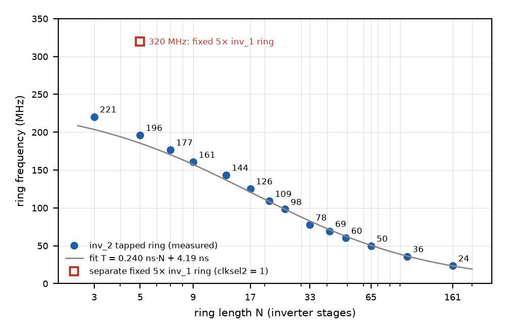
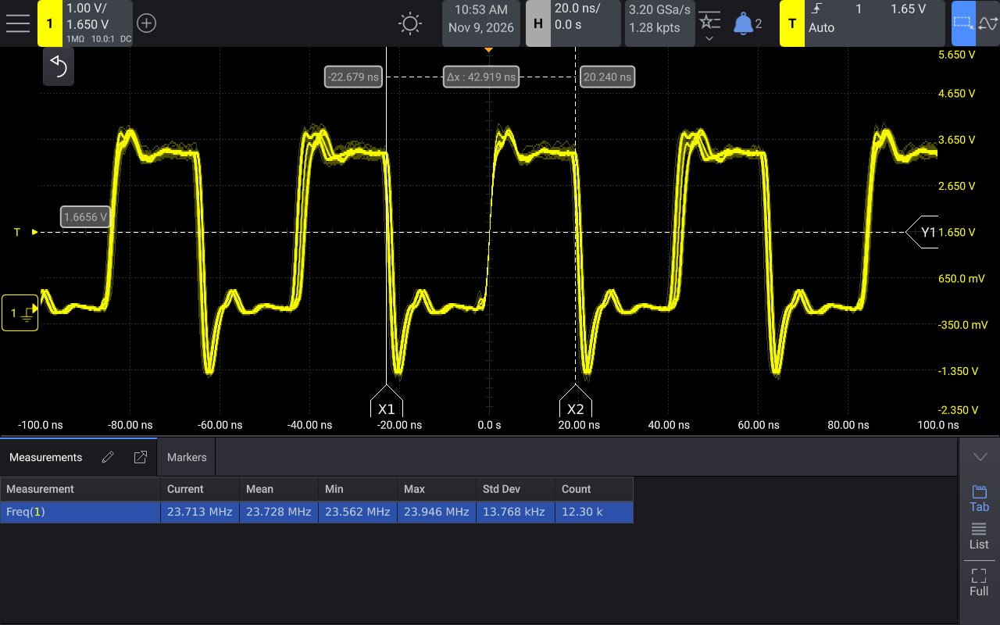
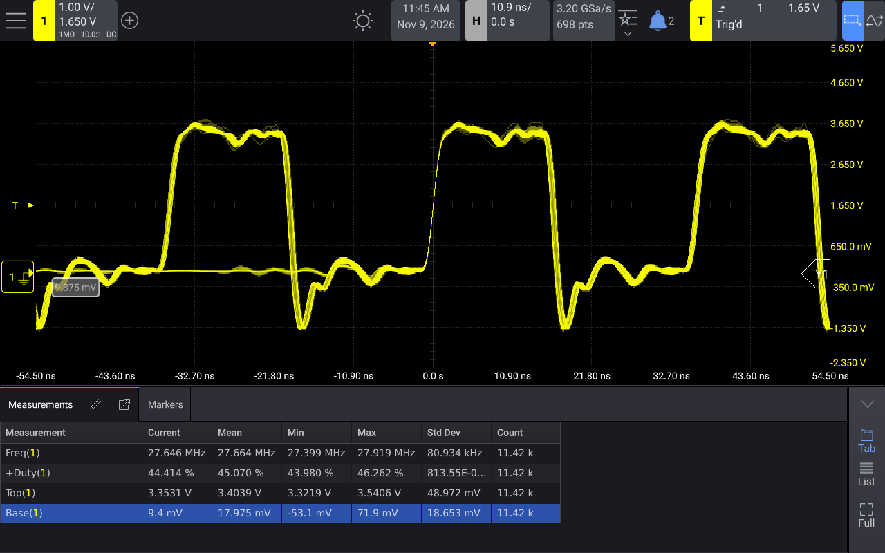
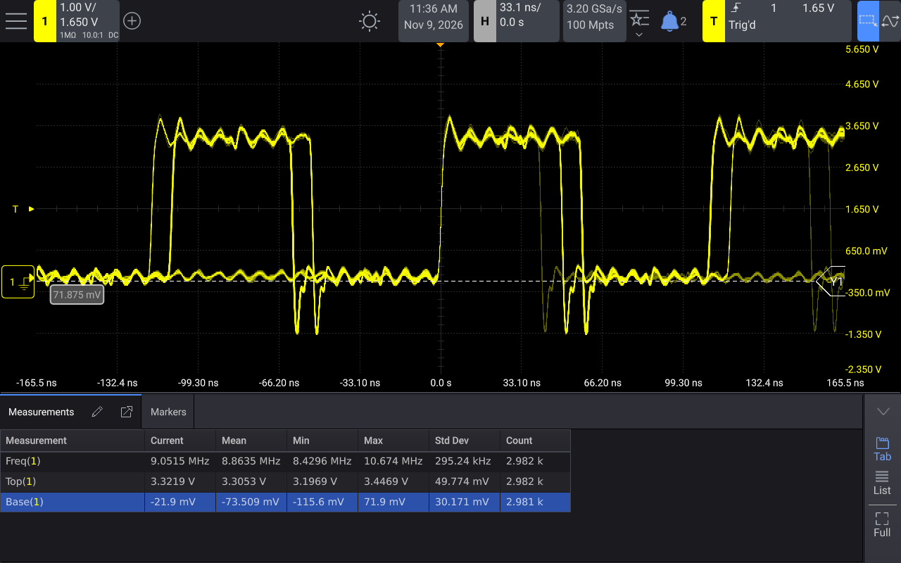

# Ring osc on VGA on ttgf0p2: silicon measurements

Measurements of [`tt_um_algofoogle_vgaringosc`](https://tinytapeout.com/chips/ttgf0p2/tt_um_algofoogle_vgaringosc)
("Ring osc on VGA" by Anton Maurovic) on the Tiny Tapeout (TT) GF180MCU shuttle **ttgf0p2**, mux address 614.
Measured by Matt Venn, 2026-11-09. Design source:
[algofoogle/ttgf0p2-vga-ring-osc](https://github.com/algofoogle/ttgf0p2-vga-ring-osc) (commit cdefb8e).

**One-page summary: [vgaringosc_ttgf0p2_report.pdf](vgaringosc_ttgf0p2_report.pdf)**

## Result
- The inv_2 tapped ring runs from **23.7 MHz (161 stages) to 220.5 MHz (3 stages)**. The separate fixed 5× inv_1
  ring runs at about **320 MHz**.
- The period fits T = 0.240 ns × N + 4.19 ns: about **120 ps per inv_2 stage** plus about 4.2 ns of fixed loop
  overhead (tap multiplexer and clock buffer).
- A second chip runs about 2 % slower (3 stages: 216.0 MHz; 5× inv_1: 311.6 MHz).
- Long taps can lock into a **harmonic mode**: switching to the 161-stage ring without a reset gave about 72.5 MHz
  (3.06× the fundamental) in 3 of 8 tries. With a project reset after each change, 12 of 12 started in the
  fundamental. **Reset the project after changing `clksel`.**

**Fig. 1.** Ring frequency against ring length, chip 1. Measured 23.7 MHz at 161 stages to 220.5 MHz at 3 stages;
fit residuals −0.66 to +0.76 ns. Red square: the separate fixed 5× inv_1 ring (clksel2 = 1), 320 MHz.

| Raw pin `uio[4]`, 161 stages | ÷8 pin `uio[7]`, 3 stages | ÷8 pin, 161 stages, harmonic mode |
|---|---|---|
|  |  |  |
| 23.728 MHz mean, s.d. 13.8 kHz over 12.3 k cycles | 27.66 MHz × 8 = 221.3 MHz | 9.05 MHz × 8 = 72.4 MHz (3rd harmonic) |

## Setup
- TT demo board TTDBv3 (RP2350 microcontroller, TT SDK 3.1.1), ttgf0p2 carrier v0.1.
- VDD_CORE 3.300 V. Project clock 25.25 MHz from the RP2350 (25.175 MHz requested). Room temperature, not
  controlled.
- Keysight HD304MSO oscilloscope, 10:1 probe, 3.2 GSa/s. The captures are 1280 × 800 screenshots from the scope.
- Ring frequency = 8 × the median of 30 single-period readings of the ÷8 output `uio[7]`. Each configuration was
  run 3 times, with a project reset in between.
- Check: `clksel = 0` gives 25.2524 MHz, 0.01 % from the RP2350 clock. ÷8 × 8 agrees with the raw-pin readings
  within 0.25 %.
- Chip 1 has ROM commit ff701baa. Chip 2 has ROM commit 7416232b.

## Files
| Path | Contents |
|---|---|
| `vgaringosc_ttgf0p2_report.pdf` | One-page summary |
| `chip1/raw_pin_uio4/` | Raw ring output on `uio[4]`. Valid only for clksel 13 to 15 (up to about 50 MHz), listed in `uio4_stats.csv` with the pad rise and fall times. `sweep_uio4.csv` is the first quick sweep: its values above about 50 MHz are **not valid**, because the pad and probe can't pass them. |
| `chip1/div8_uio7/` | ÷8 output on `uio[7]`. `sweep_div8.csv` is the main sweep (**ignore its `inv4x5` rows**: see the limits below). `final_checks.csv` holds the re-checks and the harmonic-mode test. There's one capture per configuration (`d8_*.png`, `recheck_*.png`). |
| `chip1/harmonic_mode/` | The 161-stage ring entered from clksel = 2: without a reset (`harm_0..7`) and with a reset (`harmR_0..3`). |
| `chip2/` | Second chip: `chip2.csv` and its captures. |

## Notes and limits
- **The ÷2/÷4/÷8 counter is held in reset during VGA horizontal blanking**, so `uio[7]` has a gap in each line.
  The single-period readings near the trigger aren't affected. The scope's own Mean and Min columns in some
  captures do include the gap periods.
- **The raw pin only works up to about 50 MHz.** Above that, use the ÷8 output. The 5× inv_1 ring doesn't toggle
  the raw pin at all.
- **The 5× inv_1 point is the least certain one.** Single readings spread widely at that speed, and the 3-bit
  counter, clocked at a 3.1 ns period, may be at its limit.
- **Chip 1, `uio[1]` (`clksel2[1]`):** the pad is shorted to ground, and the bond wires look intact. So
  clksel2 = 2 and 3 were measured on chip 2 only.
- **Chip 2:** only `ui_in[1]`, `ui_in[7]` and `uio[0..3]` reach the chip. That allows only the 3-stage tap, the
  fixed rings and the clock paths.
  - clksel2 = 3 (`!clk`) works.
  - **5× inv_4 ring:** the median is 206.5 MHz, but the ÷8 output is irregular (duty cycle 23 to 92 %), so treat
    that value as **unconfirmed**.
- **TT SDK tip:** after enabling the project, `uio[0]` and `uio[1]` stayed as RP2350 inputs even though
  `uio_oe_pico = 0b11`. Set them explicitly with `Pin.OUT`.
- **Not tested:** the VGA output (no VGA PMOD), and `altclk` with a clock. Measurements are at one supply voltage
  and at room temperature only.

## Licence
The data and figures are released under [CC BY 4.0](https://creativecommons.org/licenses/by/4.0/).

